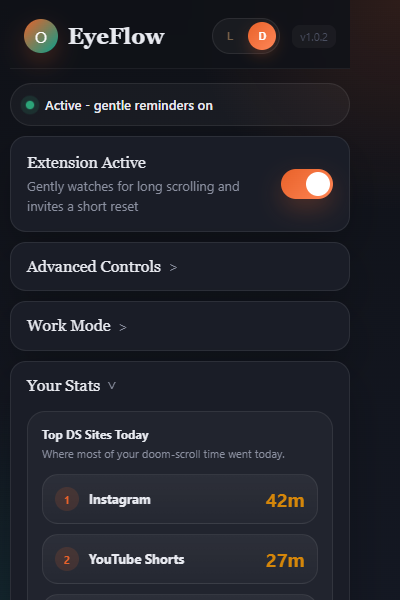
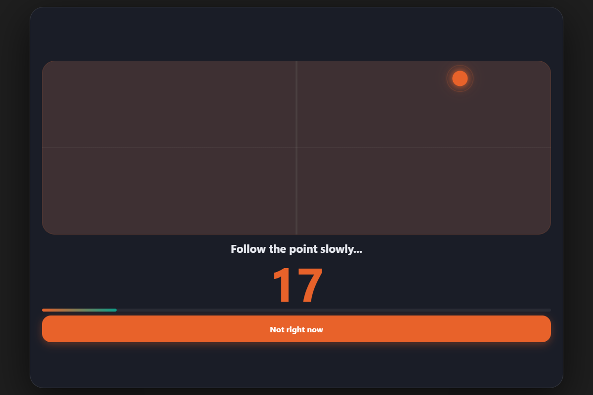
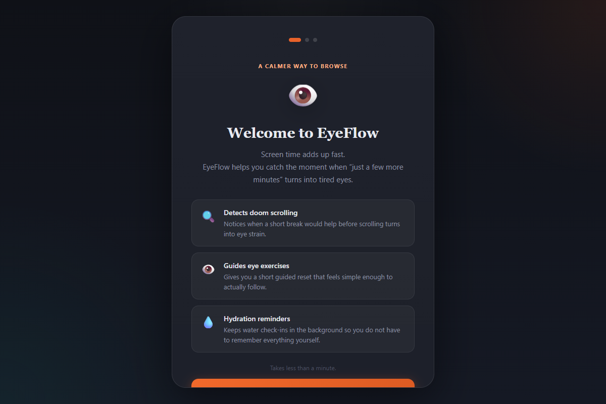

<div align="center">

# 👁️ EyeFlow

### A Chrome Extension That Fights Doom Scrolling — And Looks After Your Eyes

[](https://github.com/kumaraharsh84/eye_flow_chrome_extension)
[](https://developer.chrome.com/docs/extensions/mv3/)
[](LICENSE)

<br/>

> You open Instagram for 5 minutes. Two hours later, your eyes hurt and you forgot to drink water.
> EyeFlow watches for that loop — and quietly breaks it.

<br/>

---

</div>

## What Is This?

EyeFlow is a Chrome extension that detects doom scrolling on feeds like **Instagram Reels, YouTube Shorts, Reddit, Facebook, and X**, and responds with:

- **Guided eye-break exercises**: a moving dot you follow with your eyes for 20 seconds
- **Gentle reminders** during normal browsing, when you have been looking at a screen for a while
- **Water reminders**, because nobody remembers to drink while deep in a scroll loop

It works for your own habits, and it can also send a weekly report so you can keep an eye on a younger sibling's scrolling time.

---

## Screenshots

| Popup                                | Eye Break Overlay                        | Onboarding                                     |
| ------------------------------------ | ---------------------------------------- | ---------------------------------------------- |
|  |  |  |

---

## Features

### Core

| Feature                         | Description                                                                       |
| ------------------------------- | --------------------------------------------------------------------------------- |
| 🔍 Doom-scroll detection        | Knows the feed surfaces of 9 platforms and ignores chats, profiles and settings   |
| 👁️ Fullscreen eye-break overlay | Guided exercise with a moving dot, countdown and progress bar; the feed is paused |
| 💧 Water reminder               | Every 1 to 4 hours; a toast on normal pages, a short water break on feeds         |
| 😌 Post-break check-in          | Mood tap, time on site, and a "close tab and step away" button                    |
| 🔔 Gentle reminder              | Small toast on normal pages, never on banking, sign-in, meeting or video pages    |
| 🔊 Background chime (optional)  | A soft sound every 20 to 30 min while Chrome is open but not the window in front  |
| ⌨️ Break on demand              | `Ctrl+Shift+E` (`Command+Shift+E` on Mac) starts an eye break on the current page |

### Smart Behavior

| Feature                  | Description                                                                         |
| ------------------------ | ----------------------------------------------------------------------------------- |
| 🎯 Context-aware         | Instagram DMs, login pages, payment flows and typing never trigger anything         |
| ⏱️ Active time only      | The break timer runs only while you are actually scrolling or watching short videos |
| 🔄 One shared timer      | Hopping from Instagram to YouTube Shorts to Reddit continues the same break cycle   |
| 😴 Idle aware            | Walk away and the timers hold; lock the screen and the session resets               |
| ⏸️ Work mode snooze      | Pause gentle reminders for 1h, 2h or 4h. Doom-scroll protection stays on            |
| 🪶 Light on normal pages | Outside the tracked sites the extension runs no timers and sends no messages        |

### Control

| Feature               | Description                                                                        |
| --------------------- | ---------------------------------------------------------------------------------- |
| ⚙️ Popup settings     | Sensitivity, fixed or surprise timing, break length, reminder toggles              |
| 🎨 Dark / light theme | For the popup                                                                      |
| 📊 Stats              | Today's top doom-scroll sites and your peak scrolling time                         |
| 📤 Export             | Download your stats as JSON, or a debug log as text                                |
| 📧 Weekly report      | Optional: a weekly summary posted to a webhook you provide (Formspree, Make, etc.) |
| 🧭 Onboarding         | One recommended setup on first install; everything is adjustable later             |

---

## How It Works

```
You open Instagram
    ↓
EyeFlow sees you are on a feed surface and starts counting active time
    ↓
You switch to YouTube Shorts → the same timer keeps counting
You open your DMs, or stop scrolling → the timer pauses
    ↓
The break interval is reached (5 min by default)
    ↓
Fullscreen eye break: follow the dot for 20 seconds.
The feed is paused and cannot be scrolled behind the overlay.
    ↓
Break complete → mood check → close the tab or continue
    ↓
A new cycle begins
```

On the strictest feeds (Instagram, TikTok, Reddit, Facebook, X, YouTube Shorts) the break cannot be skipped. Elsewhere there is a "Not right now" button; skipping restarts the cycle but does not count as a completed break.

The **Sensitivity** slider scales the interval: 50% uses it as set, 100% halves it, 0% stretches it by half. A break never fires sooner than 2 minutes.

---

## Supported Sites

| Site            | Counts as doom scrolling                 | Does not count                           |
| --------------- | ---------------------------------------- | ---------------------------------------- |
| **Instagram**   | Home, Explore, Reels                     | Direct messages, profiles, login         |
| **YouTube**     | Shorts, a channel's Shorts tab           | Long-form videos, everything else        |
| **Reddit**      | Home, Popular, community feeds           | Explore, News, settings                  |
| **X / Twitter** | Home, Explore, Communities, Likes, Media | Messages, notifications, profiles        |
| **Facebook**    | Home, Watch, Reels, Groups, feed filters | Messenger, Favourites and Friends feeds  |
| **TikTok**      | Everything except messages               | Messages, login                          |
| **Snapchat**    | Spotlight, Stories, Discover             | The home/sign-in page, chat              |
| **LinkedIn**    | Feed, video                              | Messaging, jobs, profiles, notifications |
| **Twitch**      | Clips feeds                              | Live channels, settings                  |

A single post (a Reddit thread, a tweet, an Instagram post, a LinkedIn post, a Twitch clip) gets a one-minute reading window before it starts counting.

---

## 👨‍👩‍👧‍👦 Sibling Monitoring (Optional)

EyeFlow can send you a weekly report of someone's doom-scrolling time. Chrome extensions cannot send email themselves, so the report is posted to a webhook service that emails it to you.

### Step 1: Set up the weekly report

1. Create a free form or webhook at [Formspree](https://formspree.io/) or [Make.com](https://make.com) and copy its **https** URL.
2. Open the EyeFlow popup and expand **Advanced Controls**.
3. Paste the URL into **Weekly Email Report** and click **Save changes**. Chrome asks you to allow access to that one address.
4. **Write down the 6-digit Removal PIN.** It is shown once and never stored in readable form.
5. Click **Send Test Report** to check that it arrives.

The report is sent on the first day Chrome is used in a new week (normally Monday). It contains break counts, compliance rate, minutes per site, the peak scrolling time, feed-hopping between sites, and a log of the last 30 sessions.

### Step 2: What gets locked

While a webhook is saved, the popup shows **"Active - Locked by Sibling Monitor"**: the on/off switch and all advanced settings are disabled. They unlock only when the Removal PIN is entered. Five wrong PINs in a row lock removal for five minutes.

### Step 3: Enable incognito tracking

Chrome disables extensions in incognito windows by default. With a webhook active, the popup shows an **Incognito Tracking** card; click **Enable** and switch on **Allow in Incognito** on the page that opens.

> The lock is visible to whoever uses the browser, by design. EyeFlow is not hidden monitoring software.

---

## Project Structure

```
eyeflow-chrome-extension/
├── src/
│   ├── manifest.json     ← Extension config (Manifest V3)
│   ├── background.js     ← Service worker: owns all state, timers, stats, weekly report
│   ├── content.js        ← Feed detection, presence tracking, in-page reminders
│   ├── overlay.js        ← Eye-break and water-break UI (pure UI, driven by content.js)
│   ├── overlay.css       ← Styles injected with the content script, scoped to EyeFlow nodes
│   ├── popup.*           ← Toolbar popup
│   ├── onboarding.*      ← First-run page
│   ├── offscreen.*       ← Hidden page that plays the optional chime
│   └── utils.js          ← Shared limits and timing helpers
├── tests/                ← Unit tests and Puppeteer browser tests
├── scripts/package.js    ← Builds the Chrome Web Store zip
├── docs/                 ← Landing page and privacy policy (GitHub Pages)
├── build.js              ← esbuild bundling into dist/
└── dist/                 ← Build output. This is the folder Chrome loads
```

How the pieces talk: content scripts on tracked sites send a heartbeat to the service worker every 2 seconds while you are actively doom scrolling. The service worker keeps the one shared timer, decides when a break is due, and tells pages what to show. All storage writes go through a single queue in the service worker, so two tabs can never overwrite each other's updates.

---

## Install Locally (Developer Mode)

> [!IMPORTANT]
> Load the built **`dist/`** folder, not `src/`. The source files are ES modules that must be bundled first.

```bash
git clone https://github.com/kumaraharsh84/eye_flow_chrome_extension.git
cd eye_flow_chrome_extension
npm install
npm run build
```

Then open `chrome://extensions/`, turn on **Developer mode**, click **Load unpacked**, and select the `dist/` folder. Requires Chrome 116 or newer.

---

## Development

| Command              | What it does                                                        |
| -------------------- | ------------------------------------------------------------------- |
| `npm run build`      | Clean build into `dist/`                                            |
| `npm run watch`      | Rebuild on change, unminified                                       |
| `npm run lint`       | ESLint over source, scripts and tests                               |
| `npm run test:unit`  | Fast unit tests in Node                                             |
| `npm test`           | Build, unit tests, then a browser smoke test                        |
| `npm run test:e2e`   | Full Puppeteer suite: onboarding, popup, live sites                 |
| `npm run test:popup` | Popup suite only (also `test:onboarding`, `test:sites`)             |
| `npm run package`    | Build and create `release/eyeflow-v<version>.zip` for the Web Store |

The browser tests open a real Chrome window. Set `CHROME_PATH` if Chrome is not in its default location.

### Publishing to the Chrome Web Store

1. Bump `version` in `src/manifest.json` and `package.json`, and add a changelog entry.
2. Run `npm run package`.
3. Upload `release/eyeflow-v<version>.zip` in the [Developer Dashboard](https://chrome.google.com/webstore/devconsole).
4. Use [store-listing.md](store-listing.md) for the listing text and the permission justifications, and link the privacy policy at `docs/privacy-policy.html` (served by GitHub Pages).

---

## Privacy

- EyeFlow has no server and no analytics. Settings and stats live in Chrome's local storage on your device.
- No remote code, fonts or other resources are loaded.
- The only data that ever leaves the device is the optional weekly report, sent to the webhook address you enter yourself.
- On websites outside the tracked list, the extension is dormant until it has a reminder to show.

Full policy: [docs/privacy-policy.html](docs/privacy-policy.html)

---

## License

MIT — use it, fork it, change it, share it.

---

<div align="center">

Built to help you pause, reset, and keep going with less strain. 👁️💧

</div>
